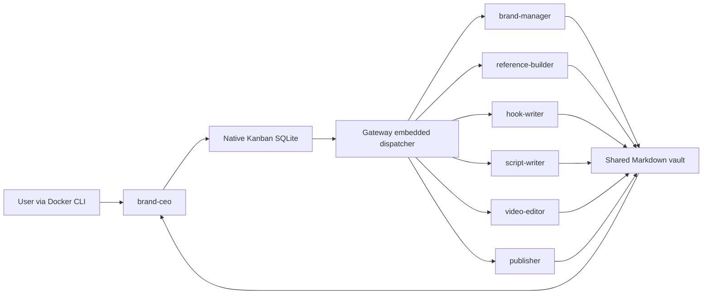

# Architecture

One Compose service uses the official Hermes image pinned by the published multi-platform index digest. Dockerfile is an optional thin alias of that exact image; no entrypoint or process replacement. Upstream s6 init remaps the hermes UID/GID, reconciles profile service slots, and drops the actual gateway and workers to that user. There is one running multiplexed gateway; named s6 slots exist but are not independent running gateways. Hermes launches separate transient worker processes inside this same container.

The requested seven named profiles live at `/opt/data/profiles/<name>`. Each owns config.yaml, profile.yaml, SOUL.md, .env, skills/, memories/MEMORY.md, memories/USER.md, sessions/ and state.db. The mandatory default root at `/opt/data` provides gateway/dispatcher infrastructure; its restricted CLI toolset is Kanban only. Do not treat its presence in `profile list` as an eighth brand agent.

Persistence uses separate local bind mounts: data/hermes → /opt/data; knowledge → /knowledge; media → /media. Versioned scripts, config, vendor reference material and seed templates are mounted read-only. The entire repository is not mounted, so agents cannot read host safety-backup directories or Git configuration through that mount. SQLite remains on local filesystem storage, never a sync vault or NFS/SMB folder. Only the Markdown knowledge folder may be opened as an Obsidian vault.

CEO uses native Kanban tools. Profiles share the native board; workers are assigned by name. Parent links gate dispatch until each producing task is done. Workers receive task/run IDs and predecessor handoffs; persist artifacts with those IDs; then call native completion/block/review tools. The CEO reviews in a separate downstream card. Automatic built-in triage decomposition is off (`kanban.auto_decompose: false`). Global/per-profile concurrency is one; review_dispatch is off so local human review cards are not auto-approved.

Shared knowledge stores evidence, drafts, canonical brand notes and artifact handoffs. Kanban stores queue/status, dependencies, runs and workflow notes. No extra task database is introduced. Deterministic verification uses an isolated native test DB under data/hermes/verification, never a production queue.

Security is container-level isolation from the host plus tool-level restrictions and collaboration conventions. All profiles use one OS user, so logical memory separation is **not** a filesystem confidentiality boundary between profiles. File tools do not become per-role ACLs. Hermes protects recognized credential/system paths, but a compromised profile could affect readable shared state. Use separate OS identities/containers only if a future threat model requires that boundary; it is not claimed here.

There is no Docker socket, privileged flag, host networking or published port. Capabilities are dropped except CHOWN/SETUID/SETGID/DAC_OVERRIDE/FOWNER for upstream bootstrap and KILL for root supervision of unprivileged children. `no-new-privileges` is enabled. The image filesystem cannot be made globally read-only without redesigning upstream init; /project inputs are read-only and native write roots are limited to /opt/data:/knowledge:/media. CPU, RAM, process and log limits bound home-server usage.

Upstream creates a strong API key and an internal authenticated localhost API required by its control plane, despite an unset external API configuration. It stays on container loopback with no port mapping. The dashboard is disabled. Model keys are static per-profile .env credentials. OAuth is not cloned. External social actions and browser/terminal/cron/delegation tools are not enabled for this initial system.

Concurrent handoffs use unique task filenames, atomic native writes, prerequisite completion gates and one worker globally. Canonical notes have one role owner. Manual chats and human Obsidian edits should submit unique proposals while a worker is editing; native stale checks are not a cross-process transaction system. Future higher concurrency needs explicit write coordination before being enabled.

Reference Builder now enables the native reference-acquisition plugin: scoped public search, single accessible video retrieval, CPU transcription, sampled-frame extraction and a bounded vision request. Heavy dependencies live in /opt/data/reference-runtime, separately from Hermes's venv. The official image/entrypoint and native execution engine remain unchanged. See [reference boundaries](references.md).

Future extensions: supplied-footage FFmpeg/Remotion production rendering, then separately approved official social integrations with human gates. Preserve disabled defaults until each integration is tested and authorized.

## Script quality checks

The local artifact-validator native Hermes plugin adds one read-only brand_artifact_check tool to CEO, Script Writer and Video Editor. It measures the spoken section, declared count, timed shot totals and per-shot speech rates; it rejects paths outside the vault, oversized files and future timestamps. It does not run tasks or replace Kanban. Text checks complement CEO judgment; actual facts, voice, footage and publication readiness still need human review.
